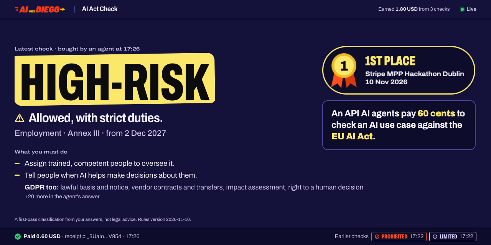
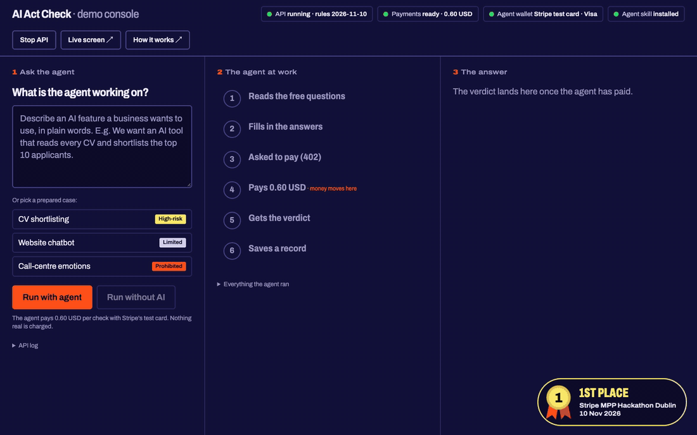
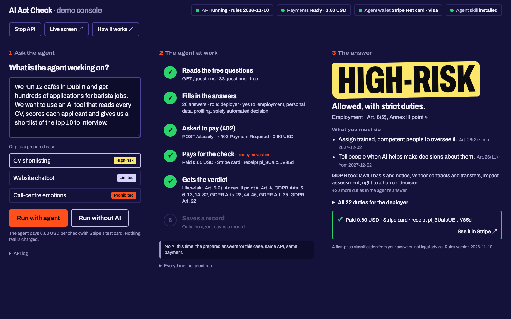
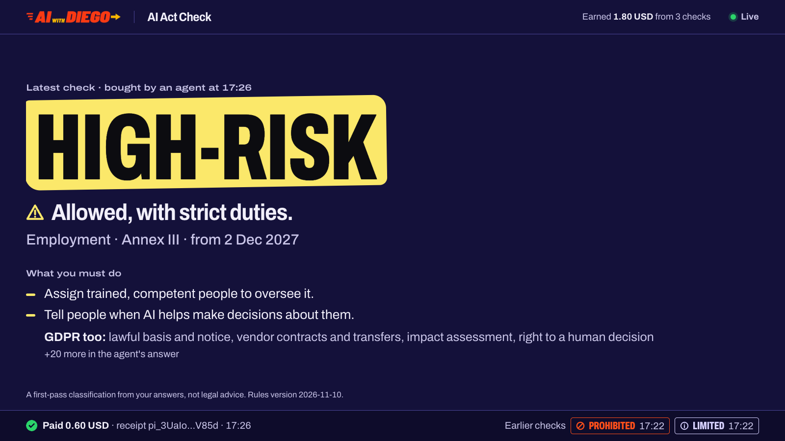
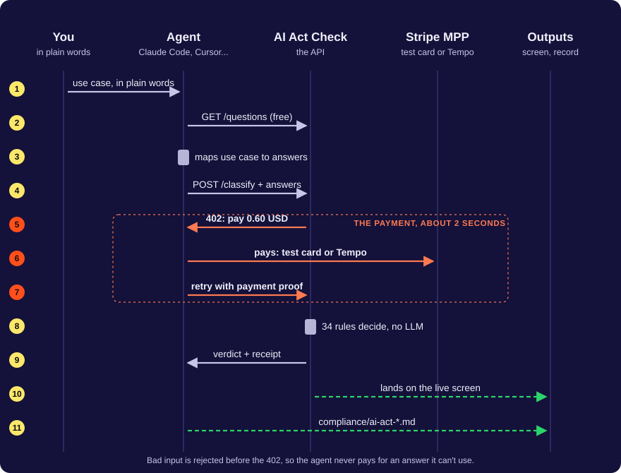

# AI Act Check

**An API AI agents pay 60 cents to check their code against the EU AI Act.**

[](#results)
[](https://aiwithdiego.github.io/ai-act-check/)
[](https://aiwithdiego.github.io/ai-act-check/design-system.html)
[](https://github.com/AIwithDiego/ai-act-check/actions/workflows/tests.yml)


[](LICENSE)

[](https://aiwithdiego.github.io/ai-act-check/)

A case study. Built at the Stripe MPP Hackathon Dublin on 10 Nov 2026, in a 90-minute build slot, with four [Devin](https://devin.ai) sessions in parallel and Claude Code as reviewer. Ranked 1st on the leaderboard.

**[Open the live demo](https://aiwithdiego.github.io/ai-act-check/)** (a replay with sample data, nothing is paid) · **[Try the real API with your agent](https://ai-act-check-flame.vercel.app)** · **[Open the design system](https://aiwithdiego.github.io/ai-act-check/design-system.html)** · [Run it yourself](#run-it-yourself)

**Contents:** [The problem](#the-problem) · [Research](#research) · [What it does](#what-it-does) · [Results](#results) · [Preparation](#preparation) · [The build](#the-build) · [Design system](#design-system) · [What went wrong](#what-went-wrong) · [What I learned](#what-i-learned) · [Run it yourself](#run-it-yourself)



## The problem

Every team shipping AI in the EU has the same question about each feature: is this banned, high-risk, a transparency case, or fine? The answer decides a lot:

- **Banned practices** (emotion recognition at work, social scoring) have applied since February 2025, with fines up to EUR 35M or 7% of turnover.
- **High-risk systems** (CV screening, credit scoring, grading students) carry duties for whoever deploys them: human oversight, logs, informing workers, impact assessments. The 2026 AI Omnibus moved those dates to 2 December 2027. Delayed, not cancelled.
- **Transparency cases** (chatbots, deepfakes) must tell people they're dealing with AI.
- **GDPR comes along** as soon as people's data is involved: lawful basis, impact assessment, the right not to be decided about by a machine alone.

Today the answer comes from a consultant, a week later, or from a 400-page regulation nobody reads. Meanwhile the code is being written by agents, at a speed no review process keeps up with.

> The compliance check happens after the code ships, by a human. We moved it to the moment the agent writes the code, and let the agent pay for it.

## Research

**What already exists.** Online AI Act compliance checkers (the best known is the Future of Life Institute's) and vendor questionnaires: web forms for humans, one session at a time, with a summary at the end. Law firms sell the same answer as advice. None of it can be called by an agent in the middle of a task, and none of it is priced per question.

**Who it's for.** The coding agent first, and through it the small business that has no compliance team. Every answer has to work for both: structured JSON with articles and dates for the agent, and a tier in plain words ("Allowed, with strict duties.") for the person reading over its shoulder.

**The limits we chose.** A rule engine, not a model. The verdict is only as good as the answers the agent gives, so the rules had to be deterministic and cited, so that a wrong verdict can be traced to a wrong answer, never to a model's mood:

- **Rule-based, no LLM in the verdict.** Same answers, same verdict, every time. Every matched rule and every duty cites its article.
- **Free discovery, paid verdict.** The questionnaire is free. Bad input is rejected before the 402, so an agent never pays for an answer it can't use.
- **Nothing about the use case is stored.** The receipts log holds time, tier, amount and receipt id.
- **Not legal advice.** The disclaimer ships in every verdict. Anything relying on the Art. 6(3) exception or police biometrics needs a lawyer.

**What I didn't build.** Free-text classification with a model (cheaper to build, impossible to audit), accounts and API keys (MPP makes them unnecessary), and other laws (Chile's Ley 21.719 is next). The hackathon brief was "build something agents pay for"; a compliance verdict is something an agent genuinely needs at a precise moment and can't produce itself without the risk of making it up.

## What it does

An agent reads 33 free questions, maps the use case it's working on to answers, and calls `POST /classify`. The server answers HTTP 402 with a price. The agent pays over Stripe's Machine Payments Protocol (MPP) and retries with proof. The rules engine returns the verdict with a receipt, the verdict lands on a live screen, and the agent saves a compliance record in its project.

| Part of the verdict | What it holds |
|---|---|
| `tier` | `prohibited`, `high`, `limited`, `minimal`, or `incomplete` with the missing questions |
| `matched` | Every rule that matched, with its article (e.g. Art. 5(1)(f), Annex III point 4) |
| `obligations` | The duties for the caller's role (provider, deployer or both), AI Act first, then GDPR, each with its article and the date it applies from |
| `gdpr_short` | The GDPR duties in a few words, for the screen |
| receipt | The MPP `Payment-Receipt` header: a Stripe PaymentIntent (`pi_...`) or a Tempo transaction |

<table>
<tr>
<td width="50%"></td>
<td width="50%"></td>
</tr>
<tr>
<td>The demo console: type a use case, watch the agent work step by step.</td>
<td>The live screen on the projector: each paid check lands as it happens.</td>
</tr>
</table>



1. **Rules engine** (`src/engine.ts`, `data/rules.json`, `data/questions.json`): a pure function. 34 rules and 33 questions over the AI Act and GDPR, checked against 14 test cases in `fixtures/cases.json`.
2. **Paid API** (`src/server.ts`, `src/payments.ts`): Hono on Node. Free `/questions`, `/llms.txt` and `/openapi.json`; paid `POST /classify` through `mppx`, with a Stripe card offer and a Tempo offer in every 402.
3. **Agent kit** (`agent/SKILL.md`): a Claude Code skill. It asks the questions, pays with the `mppx` CLI, shows the verdict and writes `compliance/ai-act-<slug>.md` in the user's project.
4. **Live screen** (`src/live.ts`, `public/`): a keynote-style page for the projector, polling the last 20 checks from memory.
5. **Demo console** (`console/`): a local control page with no dependencies. It starts the API, runs a real agent (Claude Code, headless) or a no-AI replay, and shows every step.
6. **Vercel entry** (`api/index.ts`, `vercel.json`): the same app as a serverless function, at [ai-act-check-flame.vercel.app](https://ai-act-check-flame.vercel.app).

## Results

**1st of 11 services on the [MPP Hackathon Dublin leaderboard](https://mpp-hackathon.vercel.app/)** (Stripe, 10 Nov 2026), with 9 votes, against 5 for the runner-up. The submission scan passed every required check: public origin, `/openapi.json` with `x-payment-info`, and a 402 with `WWW-Authenticate: Payment`.

Reproducible from a clone: `npm test` runs all 14 of the rule cases plus the server and live-screen tests (51 in total). The three demo verdicts:

| Use case, as a small business types it | Verdict | Why |
|---|---|---|
| "We use an AI tool to shortlist CVs for our café chain" | **High-risk** | Annex III point 4, employment. 22 duties for the deployer, from 2 Dec 2027 |
| "A chatbot answers customer questions on our website" | **Limited** | Art. 50: tell people they're talking to an AI |
| "Software that reads our call-centre staff's emotions" | **Prohibited** | Art. 5(1)(f), banned since 2 Feb 2025 |

## Preparation

The organisers gave no setup time: the build slot was 13:00 to 14:30, demo included. So everything except the code was decided the day before, in a prep pack ([PR #1](https://github.com/AIwithDiego/ai-act-check/pull/1)):

- **[`docs/brief.md`](docs/brief.md):** the problem, the three demo cases, what's out of scope.
- **[`docs/contract.md`](docs/contract.md):** the fixed spec every session coded against: the data formats, the `classify()` signature, every route. It's what let four agents build at the same time without waiting on each other.
- **[`data/`](data/) and [`fixtures/`](fixtures/):** the rules, questions and 14 test cases, written and checked before the build by Hank, the EU-compliance agent in my Claude Code team ([AIwithDiego/hank](https://github.com/AIwithDiego/hank)). Read-only for the build.
- **[`prompts/`](prompts/):** one self-contained Devin prompt per part, each naming the files it owns, what done looks like and when to stop.
- **[`docs/design-system.html`](docs/design-system.html) and [`docs/live-screen-mock.html`](docs/live-screen-mock.html):** the look of the live screen, finished before any code.
- **A payment spike:** a real sandbox payment on 9 Nov, which found that Stripe's guide was behind `mppx` 0.17.1 (see [What went wrong](#what-went-wrong)).
- **The demo layer** ([PR #3](https://github.com/AIwithDiego/ai-act-check/pull/3)): the console and a [How it works](docs/how-it-works.html) page, built and tested against a stand-in API in the morning. At the previous hackathon everything ran in the background with nothing to show; this time the demo existed before the product.

## The build

Four Devin sessions, one prompt and one PR each, in parallel. Claude Code reviewed every PR: it read the diff against the contract, ran the tests, and ran each piece against the Stripe sandbox with real test payments before I said "merge". All four were merged 41 minutes into the slot.

| PR | What landed |
|---|---|
| [#1](https://github.com/AIwithDiego/ai-act-check/pull/1) [#2](https://github.com/AIwithDiego/ai-act-check/pull/2) | The prep pack (9 Nov) |
| [#3](https://github.com/AIwithDiego/ai-act-check/pull/3) | Demo console and How it works page (morning of 10 Nov) |
| [#4](https://github.com/AIwithDiego/ai-act-check/pull/4) | Submission rules added to the spec at 13:13, before the sessions started: `/openapi.json` and a public URL |
| [#5](https://github.com/AIwithDiego/ai-act-check/pull/5) | Devin: the rules engine (13:24) |
| [#6](https://github.com/AIwithDiego/ai-act-check/pull/6) | Devin: the paid server (13:36) |
| [#7](https://github.com/AIwithDiego/ai-act-check/pull/7) | Devin: the agent kit (13:38) |
| [#8](https://github.com/AIwithDiego/ai-act-check/pull/8) | Devin: the live screen (13:41) |
| [#9](https://github.com/AIwithDiego/ai-act-check/pull/9) | Every duty in the console, not only the top three |
| [#10](https://github.com/AIwithDiego/ai-act-check/pull/10) | Card payments at 0.60 USD, so each check shows in the Stripe dashboard |
| [#11](https://github.com/AIwithDiego/ai-act-check/pull/11) [#12](https://github.com/AIwithDiego/ai-act-check/pull/12) | The API on Vercel, and a home page that tells people it's for agents |
| [#13](https://github.com/AIwithDiego/ai-act-check/pull/13) | Discovery metadata: payment offers name their method |

## Design system

**[Open the live design system](https://aiwithdiego.github.io/ai-act-check/design-system.html)** · source: [`docs/design-system.html`](docs/design-system.html) · tokens: [`public/tokens.css`](public/tokens.css)

The live screen is read by a room, from 10 metres, in 3 seconds. It works like a keynote slide: one tier word in a hand-drawn highlighter, one sentence, at most three duties.

| | |
|---|---|
| **One answer per screen** | The tier word is 230 px on a 1920 canvas. Everything else serves it. |
| **The brand, not a new look** | Colours, Archivo's width axis and the highlighter come from the aiwithdiego.com site. |
| **Colour never says it alone** | Every tier has a word and a glyph as well as a colour. |
| **One motion** | Only the highlighter moves, once, when a new check arrives. Reduced motion turns it off. |
| **Scales to any projector** | Sizes are design pixels times one unit tied to the viewport, so 1920, 1280 or 4:3 show the same picture. |

Body text on the night background measures 15.8:1, secondary text 10.8:1, and every tier colour holds at least 5.4:1 against it. The design system page shows the tokens and every component of the screen with real markup.

## What went wrong

| | |
|---|---|
| **The official guide was behind the library.** Stripe's MPP guide didn't match `mppx` 0.17.1: the server needed a store and an awaited method list. The payment spike found it the day before, and prompt 02 shipped the working code. | [#1](https://github.com/AIwithDiego/ai-act-check/pull/1) |
| **The submission rules arrived with the build.** The hackathon page asked for a public URL and `/openapi.json` with payment info, neither in the spec. They went into the contract and prompt 02 at 13:13, before the first session started. | [#4](https://github.com/AIwithDiego/ai-act-check/pull/4) |
| **A payment nobody could see.** Link isn't available in Ireland, so the agent paid on Tempo testnet. The money moved, but Stripe can't record crypto outside the US without approval, so the dashboard stayed empty. We switched to a test card through a Shared Payment Token. | [#10](https://github.com/AIwithDiego/ai-act-check/pull/10) |
| **50 cents is below Stripe's minimum.** The account settles in euros, 0.50 USD is about EUR 0.45, and the card minimum is EUR 0.50. The price became 0.60. | [#10](https://github.com/AIwithDiego/ai-act-check/pull/10) |
| **The line no session owned.** Session 02 mounted a stub live screen and session 04 built the real one; switching between them was in neither prompt. The review caught that `/live` would still be a 404 after the merge. | [#8](https://github.com/AIwithDiego/ai-act-check/pull/8) |
| **Two agents wrote the same README section.** The server and the agent kit both added "Run". A merge conflict, resolved in review. | [#7](https://github.com/AIwithDiego/ai-act-check/pull/7) |
| **A serverless entry that never answered.** The first Vercel entry exported a handler in a shape the Node runtime didn't call, so every request timed out with a 504. Exporting web-standard `GET` and `POST` handlers fixed it. | [#11](https://github.com/AIwithDiego/ai-act-check/pull/11) |

## What I learned

- **Build the demo before the product.** The console and How it works page were tested against a stand-in API before 13:00, so at 13:45 there was something to press and something to show.
- **A fixed contract is what makes parallel agents work.** Four sessions shared one file of formats and signatures, and none of them waited on another.
- **Review with real money, even test money.** Every PR ran against the Stripe sandbox before merge. The tests passed in all of them; only the real payments found the 404 and the dashboard gap.
- **Deterministic beats clever when someone pays.** A rule engine with articles is something an agent can pay for and a person can check. A model's opinion isn't.
- **Show the money where the audience lives.** In Stripe's office, a payment in the Stripe dashboard said more than a blockchain explorer, so it was worth the switch an hour before the demo.

**What's next:** the same check as a paid MCP tool, so Claude or ChatGPT can call it and pay inside the chat, then Chile's data protection law, Ley 21.719.

## Ground rules

- **Not legal advice.** A first-pass classification from the answers given. The disclaimer is in every verdict.
- **Nothing about the use case is stored.** The receipts log holds time, tier, amount and receipt id. The live screen keeps the last 20 verdicts in memory only.
- **`data/` and `fixtures/` change only with a source.** Rules and dates come from the regulation, the AI Omnibus and official guidance, never from a model.
- **Sandbox only.** The hosted API runs on a Stripe sandbox. No real money moves.

## Run it yourself

Node 22+ and a Stripe sandbox (secret key and a `profile_test_...` business profile, from the MPP section of the Stripe dashboard).

```bash
git clone https://github.com/AIwithDiego/ai-act-check && cd ai-act-check && npm install
cp .env.example .env              # STRIPE_SECRET_KEY, STRIPE_PROFILE_ID, PRICE_USD=0.60
npm test                          # 51 tests, no network
npm run dev                       # API on http://localhost:4242, live screen at /live
node console/server.mjs           # demo console on http://localhost:4343
```

To pay from your own agent instead, give it [`agent/SKILL.md`](agent/SKILL.md), or follow the two steps on [the hosted home page](https://ai-act-check-flame.vercel.app) with free Tempo testnet money.

## Repo map

```
src/
  engine.ts          the rules engine: classify() and validate()
  server.ts          the API: free routes, the paid /classify, openapi.json, llms.txt
  payments.ts        mppx and Stripe setup
  live.ts            the live screen's feed and routes
api/index.ts         the Vercel entry
data/                34 rules and 33 questions (Hank's, read-only for the build)
fixtures/cases.json  14 test cases with the expected verdicts
agent/               the Claude Code skill and an example compliance record
console/             the demo console, no dependencies
public/              live screen, design tokens and fonts
prompts/             the four Devin prompts
docs/                brief, contract, run sheet, pitch, design system, How it works, demo site
demo/                the demo script and request bodies
tests/               engine, server and live-screen tests
```

## Credits

Built with [Devin](https://devin.ai) (four sessions) and [Claude Code](https://claude.com/claude-code) (prep, review, demo layer). Payments by Stripe's [Machine Payments Protocol](https://docs.stripe.com/payments/machine/mpp) and [`mppx`](https://mpp.dev). Rules and test cases by [Hank](https://github.com/AIwithDiego/hank). Typeface: Archivo (SIL OFL). Thanks to Stripe for hosting the MPP Hackathon in Dublin.

## Licence

MIT · Made in Dublin by [Diego Bauer](https://www.aiwithdiego.com) · [LinkedIn](https://www.linkedin.com/in/diego-bauer-domeyko/)

Built by [AIwithDiego](https://www.aiwithdiego.com). Need something like this for your team? [Talk to me](https://www.aiwithdiego.com).
